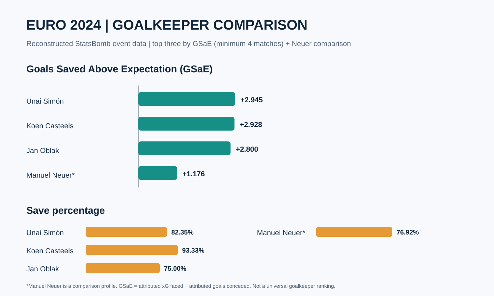

# LinkedIn project post — Euro 2024 Goalkeeper Analytics

I reconstructed my soccer analytics project on goalkeeper performance at the UEFA Euro 2024 Men's Championship.

The project examines three dimensions of goalkeeper performance:

- **Shot-stopping:** shots faced, saves, save percentage, expected goals faced (xG) and Goals Saved Above Expectation (GSaE)
- **Goalkeeper actions:** claims, punches and sweeper actions
- **Distribution:** goal-kick volume and average goal-kick length

The GitHub project includes a Streamlit dashboard structure with four individual goalkeeper profile tabs:

1. Koen Casteels
2. Unai Simón
3. Fehmi Mert Günok
4. Predrag Rajković

**Methods and tools:** Python, Pandas, NumPy, Streamlit, Plotly, event-data processing, Z-score standardization and correlation analysis.

**Reproducibility note:** My original notebooks and local data were lost, so this is a transparent reconstruction from my surviving project report and the public StatsBomb event data. I have corrected the goalkeeper-event parsing and added a data-link coverage audit. Reconstructed values are kept separate from figures reported in the original presentation; they should not be treated as validated until the pipeline and tests have been run against the complete tournament data.

**Data source:** StatsBomb Open Data (UEFA Euro 2024, competition 55, season 282).

Project repository:
https://github.com/prashanthk7/euro-2024-goalkeeper-performance-analysis

#SoccerAnalytics #FootballAnalytics #SportsAnalytics #Python #DataAnalytics #GoalkeeperAnalysis #StatsBomb

## Updated dashboard showcase

Four event-level goalkeeper dashboards follow the supplied reference: shot-danger map, claims/punches map, long and short distribution maps, shots/set-piece summary and Z-score radar.

**Top three by reconstructed GSaE (minimum four matches):** Unai Simón (+2.945), Koen Casteels (+2.928), Jan Oblak (+2.800). Manuel Neuer is included as a comparison profile (+1.176). Save rates: 82.35%, 93.33%, 75.00% and 76.92%, respectively. GSaE = attributed xG faced minus attributed goals conceded. This is a transparent shortlist, not a universal goalkeeper ranking; reconstructed values are distinct from figures transcribed from the original report.

## LinkedIn visual to attach

The repository includes a vector comparison chart at `charts/euro-2024-goalkeeper-comparison.svg`, comparing reconstructed GSaE and save percentage for Unai Simón, Koen Casteels, Jan Oblak and Manuel Neuer. Download the SVG (or export it to PNG) and upload it as an image when publishing this post. The Streamlit dashboard also includes interactive GSaE and save-percentage comparison charts and an individual save-percentage chart in each player profile.
